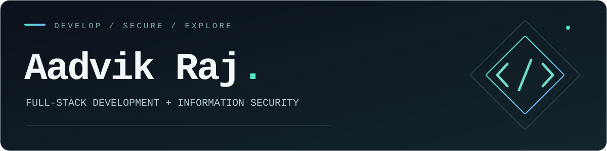

  

  <a href="https://github.com/aadvik1864?tab=repositories"><kbd> REPOSITORIES ↗ </kbd></a>&nbsp;&nbsp;
  <a href="https://www.linkedin.com/in/aadvik-raj-0521912a8/"><kbd> LINKEDIN ↗ </kbd></a>&nbsp;&nbsp;
  <a href="https://github.com/aadvik1864?tab=stars"><kbd> EXPLORING ↗ </kbd></a>

 

I build web applications and security tools with **Python, TypeScript, and React**. BCA student in **Cloud Technology & Information Security** at Jain (Deemed-to-be University), 2024–2027.

 

<b>01 &nbsp; / &nbsp; Toolkit</b>

 

| Area | Technologies |
| --- | --- |
| Languages | Python, TypeScript, JavaScript, SQL |
| Backend | FastAPI, Flask, REST APIs, SQLAlchemy |
| Frontend | React, Next.js, Tailwind CSS |
| Data | PostgreSQL, MySQL, SQLite, Redis, Supabase, Prisma |
| Deployment | Docker, Linux, Git, Vercel, Render, Cloudflare R2 |

<b>02 &nbsp; / &nbsp; Interests</b>

 

- Web application security, CTFs, and vulnerability research.
- Authentication, access control, and secure backend development.
- Log monitoring and practical cloud deployment.
- Useful applications built with AI integrations.

<b>03 &nbsp; / &nbsp; Beyond the code</b>

 

- **3rd place** — DecipherX, a team-based 24-hour CTF at St. Francis College.
- **Agentrix 2026** — Built with Team Lua at Jain University.
- **Odoo Hackathon** participant.
- **Bug Bounty certification** — Indian Cyber Club, July 2025.

