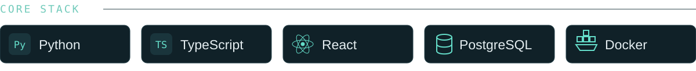
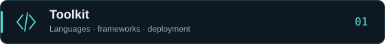
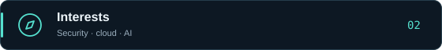
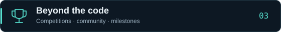

  

  <a href="https://github.com/aadvik1864?tab=repositories"><kbd> REPOSITORIES ↗ </kbd></a>&nbsp;&nbsp;
  <a href="https://www.linkedin.com/in/aadvik-raj-0521912a8/"><kbd> LINKEDIN ↗ </kbd></a>&nbsp;&nbsp;
  <a href="https://github.com/aadvik1864?tab=stars"><kbd> EXPLORING ↗ </kbd></a>

 

  <b>Building across the stack.</b> 
  Web applications, APIs, and security tools. 
  BCA · Cloud Technology &amp; Information Security · Jain University · 2024–2027

 

  

 

<picture></picture>

 

| Area | Technologies |
| --- | --- |
| `Languages` | Python, TypeScript, JavaScript, SQL |
| `Backend` | FastAPI, Flask, REST APIs, SQLAlchemy |
| `Frontend` | React, Next.js, Tailwind CSS |
| `Data` | PostgreSQL, MySQL, SQLite, Redis, Supabase, Prisma |
| `Deployment` | Docker, Linux, Git, Vercel, Render, Cloudflare R2 |

 

<picture></picture>

 

| Focus | What draws me in |
| --- | --- |
| `Security` | Web application security, CTFs, and vulnerability research |
| `Backend` | Authentication, access control, and secure development |
| `Cloud` | Log monitoring and practical deployment |
| `AI` | Useful applications with AI integrations |

 

<picture></picture>

 

| Milestone | The experience |
| --- | --- |
| 🥉 **3rd place** | DecipherX · Team-based 24-hour CTF at St. Francis College |
| ⚡ **Agentrix 2026** | Built with Team Lua at Jain University |
| 🛠️ **Odoo Hackathon** | Participant |
| 🎓 **Bug Bounty** | Indian Cyber Club certification · July 2025 |

